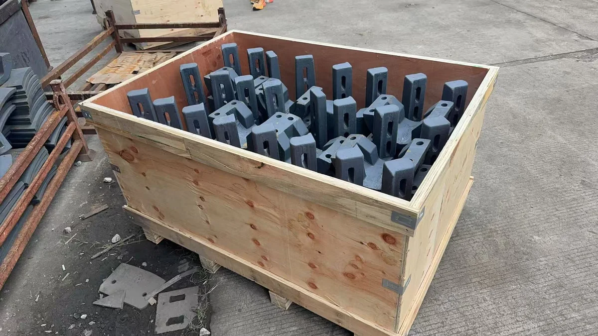
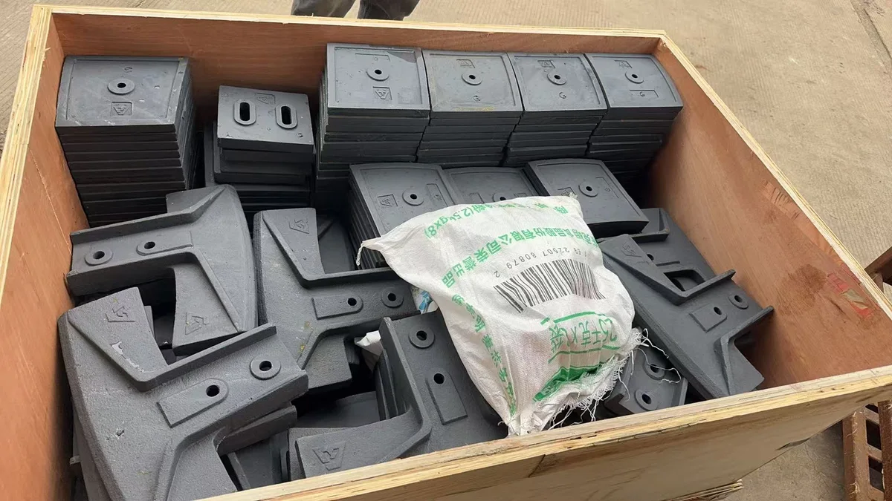
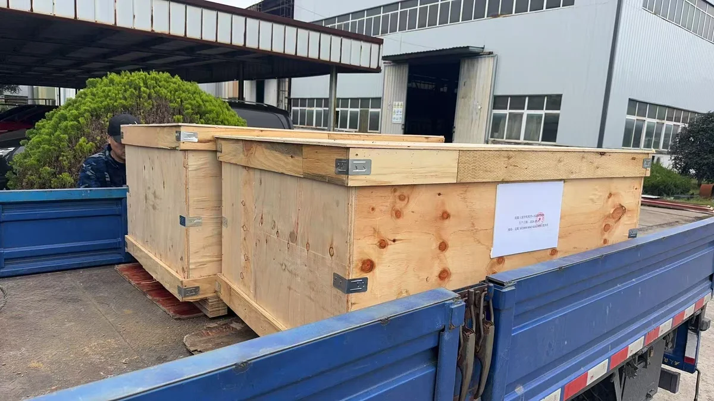

# Sureay Ships Wear Parts to Poland for SICOMA MAO 6000/4000 Mixer

Sureay Machinery Technology has shipped a complete set of replacement wear parts to a concrete batching plant in Poland. The parts were manufactured to fit the plant's Italian-made SICOMA MAO 6000/4000 mixer, and the order was dispatched within the agreed 20-day lead time.

## Two Liner Sets for One Mixer

The customer specified cast iron for the trough liners and Ni-Hard for the end-wall liners. The trough set alone comprised 216 tiles in three designs, together with mounting screws, nuts and springs. The order also included 20 mixing arms, 20 mixing paddles and 24 arm clamps, as well as left- and right-hand scraper arms and paddles.

## Fit and Material Requirements

Every mounting hole had to align precisely with its counterpart on the original mixer, and all installation dimensions had to match. The buyer required brand-new parts and rejected any castings or forgings with cracks, sand holes or other defects. A material test certificate, as requested, accompanied the order.

## Export Packing

Liner plates were stacked flat and mixing arms were packed upright in plywood export crates. Once the lids were secured, the crates were loaded onto a truck for delivery to Poland.

